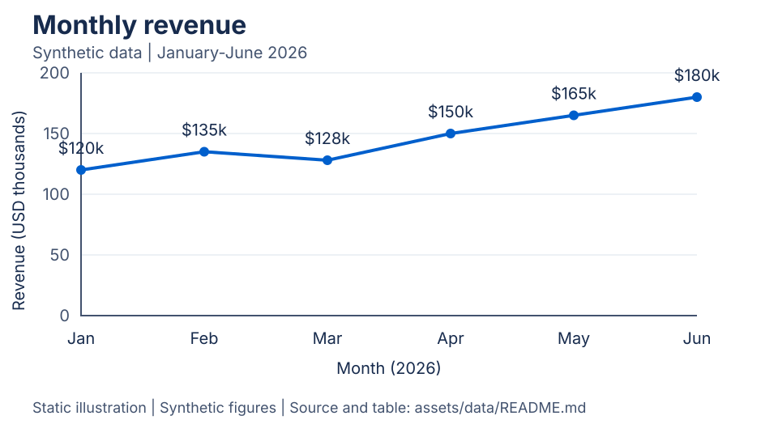
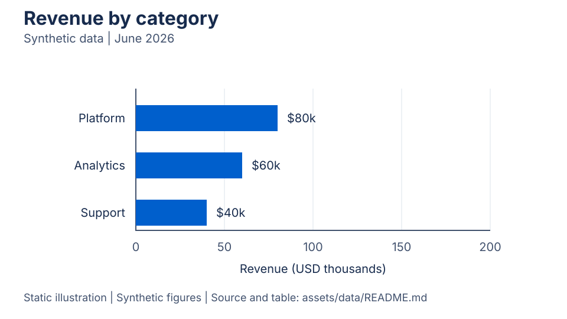

# Data Visualizer

Chart guidance for developers who want to make a useful chart before arguing about which shade of blue to use.

Data Visualizer is a small library of Agent Skills, chart briefs, design tokens, and worked examples. It helps you decide what to draw, explain your choices, and catch misleading or inaccessible details before a chart reaches an audience.

> **Demo scope**
> This repository was created for a Microsoft Ignite demo. It contains documentation and static illustrations, not a chart-rendering package or working application. All sample data is synthetic. It is an independent demo with no Microsoft endorsement.

Our examples use the same synthetic revenue figures throughout, so you can compare the source data with the chart decisions. Here is the monthly example:



January starts at $120,000 and June ends at $180,000. March dips to $128,000 along the way. A line chart makes that sequence easy to follow; it doesn't tell us what caused the changes.

## Start with a question

"Make a chart" leaves a lot unresolved. Are we comparing categories, following change over time, or trying to understand a distribution? Those questions need different visual choices.

For the monthly dataset, a useful question is: "How did synthetic monthly revenue change between January and June 2026?" We have an ordered time field, one revenue measure, and a single series. That gives us enough to write a chart brief without inventing a story about customers or sales campaigns.

The [chart selection reference](references/chart-selection.md) explains these choices and the cases where another chart would work better.

## Work with the skills

The skills live in the repository's `.github/skills/` directory. Use an agent environment that supports repository Agent Skills, with this checkout available as its workspace. Discovery and activation depend on your agent host; this repository doesn't install or configure that host.

If your host doesn't discover them automatically, explicitly attach the relevant `SKILL.md` and its linked resources. You can also read them as ordinary workflow guides. There is no dependency installation or runtime command.

| Skill | Use it when you need | Starting point |
| --- | --- | --- |
| `choose-chart` | A chart recommendation and a concrete brief | [Selection workflow](.github/skills/choose-chart/SKILL.md) |
| `style-chart` | Layout, labels, palette, and accessibility decisions | [Styling workflow](.github/skills/style-chart/SKILL.md) |
| `review-chart` | An evidence-based review before sharing a chart | [Review workflow](.github/skills/review-chart/SKILL.md) |

Try this request after loading `choose-chart`:

```text
Use choose-chart with assets/data/monthly-revenue.csv.
The audience is developers watching a conference demo.
Recommend a chart for revenue change over time and return a JSON brief.
Keep the synthetic-data disclosure and explain one rejected alternative.
```

The expected result is a brief like [monthly-revenue.json](assets/briefs/monthly-revenue.json): field mappings, units, scale decisions, a rationale, and accessible summary text. It is a planning artifact, not executable chart configuration.

Then load `style-chart` and ask:

```text
Style the monthly revenue brief using assets/design/chart-tokens.json.
Specify a light-background slide layout, readable labels, and a text alternative.
Do not create a rendering implementation.
```

Finally, use `review-chart` to inspect the [static SVG](assets/examples/monthly-revenue.svg) alongside the CSV and brief. Ask for findings tied to exact elements, proposed fixes, and anything the supplied evidence can't establish.

## Explore the bundled examples

The [data notes](assets/data/README.md) define the fields, synthetic-data status, and expected values. Both CSVs are intentionally small enough to inspect without another tool.

For a category comparison, our question changes to "Which synthetic product category has the highest June revenue?" Here is that static example:



The [category brief](assets/briefs/category-comparison.json) uses horizontal bars, descending order, and a zero baseline. Its values total $180,000, matching June in the monthly example. That relationship is deliberate so the demo can move between an overview and a category breakdown.

## Keep the evidence intact

Don't replace missing values with zero, quietly trim an axis, or describe a correlation as a cause. Keep units visible and distinguish a percentage change from a percentage-point change. A color palette alone also can't make a chart accessible; readable text, non-color cues, and a nearby data table still matter.

When adapting these resources, update the CSV, brief, illustration, and text together. Use synthetic or explicitly authorized data, and keep confidential inputs out of demo materials. The useful outcome here is a chart decision someone else can inspect and question before any rendering work begins.
